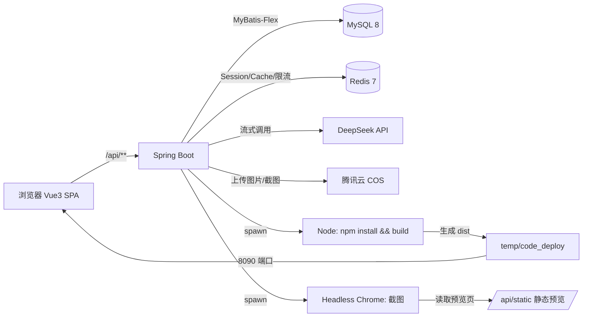

# 天空之梦 · AI 应用生成器

> 输入一句提示词，AI 帮你生成可运行的网站应用 —— 支持单文件 / 多文件 / Vue3 工程三种模式、
> 可视化编辑、一键部署、自动截图封面，并配套社区交流与素材库。

[](https://openjdk.org/)
[](https://spring.io/projects/spring-boot)
[](https://vuejs.org/)
[](https://www.mysql.com/)
[](https://redis.io/)

---

## 1. 项目简介

这是一个「AI 应用生成器」全栈项目：用户在首页输入一句自然语言描述，系统调用大模型流式生成
一个可直接运行的网站（原生 HTML / 多文件 / 完整 Vue3 工程），生成结果支持静态预览、可视化编辑、
一键部署、自动截图生成封面，并可以在社区里分享作品、交流经验。

项目定位：**个人全栈练习 + 求职作品集**，因此在工程上刻意做了这些取舍：
真实可跑的三种代码生成模式、可观测的错误处理、限流与缓存、按用户隔离的素材与社区数据。

## 2. 功能特性

| 模块 | 能力 |
|---|---|
| AI 生成 | 一句提示词生成网站；`html` / `multi_file` / `vue_project` 三种模式；SSE 流式输出 + 打字机效果；对话历史持久化与上下文记忆（Redis） |
| 可视化编辑 | 预览 iframe 与主页面同源，选中页面元素后把元素信息拼进提示词再生成（DOM 注入 + postMessage 回传） |
| 部署与封面 | 一键部署到静态目录并通过 8090 端口对外访问；无头 Chrome 截图作为应用封面并上传对象存储 |
| 社区 | 发帖（草稿/发布）、标签、关键词搜索、按点赞/浏览排序、点赞幂等、两级评论盖楼、评论数/浏览数同步 |
| 素材库 | 上传图片（COS 优先、本地兜底）、分页搜索、复制链接、删除保护、一键用作社区帖子封面 |
| 账号与权限 | Cookie 会话（Redis Session）、普通用户 / 管理员分角色；管理员可管用户、应用、对话 |
| 稳定性 | Redisson 限流（对话 5 次/分、发帖 5 次/分、评论 3 次/分、上传 20 次/分）、Spring Cache + Redis 缓存精选列表、统一异常处理与错误码 |

## 3. 技术栈

| 层 | 选型 |
|---|---|
| 后端 | Java 21、Spring Boot 3.4.3、MyBatis-Flex 1.11.8、LangChain4j 1.1.0（DeepSeek） |
| 存储 | MySQL 8、Redis 7（Session / 缓存 / 限流 / 对话记忆）、腾讯云 COS（图片与截图） |
| 前端 | Vue 3.5、TypeScript、Vite 7、Ant Design Vue 4、Pinia、Axios |
| 工具链 | Maven、Selenium + Headless Chrome（截图）、`@umijs/openapi`（接口代码生成） |

## 4. 系统架构



## 5. 目录结构

```
wjx-ai-agent-project-back/
├── pom.xml
├── src/main/java/com/wjx/wjxaiagentprojectback/
│   ├── ai/                    # LangChain4j 模型配置、路由、工具、护栏
│   ├── code/                  # 代码生成门面（三种模式）
│   ├── core/                  # 构建器（Vue 工程）、流式处理、报告
│   ├── controller/            # app / user / chatHistory / community / material / static
│   ├── service/               # 业务层与实现
│   ├── mapper/                # MyBatis-Flex Mapper
│   ├── damon/                 # entity / dto / vo / enums
│   ├── config/                # Redis、COS、跨域、静态资源、JSON 序列化
│   ├── aop/                   # 限流切面
│   ├── exception/             # 统一错误码与全局异常处理
│   └── sql/                   # 建表脚本（4 个，首次部署按顺序执行）
├── temp/                      # 运行期产物（git 忽略）：code_output / code_deploy / material
└── wjx-ai-agent-project-fronted/   # 前端工程（Vue3 + TS + Vite）
```

## 6. 快速开始

### 6.1 环境要求

| 依赖 | 版本 | 说明 |
|---|---|---|
| JDK | 21 | Spring Boot 3.x 要求 |
| Maven | 3.9+ | 构建 |
| MySQL | 8.0+ | 业务数据 |
| Redis | 7+ | Session / 缓存 / 限流，**必须设密码或改配置** |
| Node.js | 20+ | 前端构建；后端「Vue 工程模式」也会调用 npm |
| Chrome | 最新稳定版 | 可选：应用封面截图使用；无 Chrome 时截图功能不可用，其余功能正常 |

### 6.2 初始化数据库

```bash
mysql -uroot -p --default-character-set=utf8mb4 < src/main/java/com/wjx/wjxaiagentprojectback/sql/create_table_user.sql
mysql -uroot -p --default-character-set=utf8mb4 wjx_ai_code_project < src/main/java/com/wjx/wjxaiagentprojectback/sql/create_table_app_chat_history.sql
mysql -uroot -p --default-character-set=utf8mb4 wjx_ai_code_project < src/main/java/com/wjx/wjxaiagentprojectback/sql/create_table_community.sql
mysql -uroot -p --default-character-set=utf8mb4 wjx_ai_code_project < src/main/java/com/wjx/wjxaiagentprojectback/sql/create_table_material.sql
```

> Windows 下务必带 `--default-character-set=utf8mb4`，否则中文默认标签会变乱码。
> 建库后可先在页面注册一个账号；如需管理员，手动把该用户 `userRole` 改成 `admin`。

### 6.3 配置密钥

```bash
cd src/main/resources
cp application-local.example.yml application-local.yml
# 编辑 application-local.yml，填入：
#   - DeepSeek API Key（3 个模型配置各一处）
#   - 腾讯云 COS 的 host / secretId / secretKey / region / bucket
#   - Redis 密码
```

> `application-local.yml` 已加入 `.gitignore`，**不会也不应该**提交到仓库。
> 没有 COS 也能跑：素材上传会自动回退到本地 `temp/material/`，只是地址变成 `/api/material/file/...`。

### 6.4 启动后端

```bash
# 方式一：IDEA 直接运行 WjxAiAgentProjectBackApplication
# 方式二：命令行打包运行
mvn clean package -DskipTests
java -jar target/wjx-ai-agent-project-back-0.0.1-SNAPSHOT.jar
```

后端默认 `http://localhost:8123/api`（context-path = `/api`）。

### 6.5 启动前端

```bash
cd wjx-ai-agent-project-fronted
npm install
npm run dev        # http://localhost:5173，Vite 已配置 /api → 8123 代理
```

### 6.6 验证

```bash
curl http://localhost:8123/api/health     # {"code":0,"data":"health","message":"ok"}
```

打开 `http://localhost:5173`，登录后即可在首页输入提示词生成应用。

## 7. 主要接口

统一返回信封：`{ "code": 0, "data": ..., "message": "ok" }`；`code` 为 0 表示成功，
`40100` 未登录、`40101` 无权限、`40400` 不存在、`40000` 参数错误、`42900` 限流、`50000` 系统错误。

| 模块 | 方法与路径 | 说明 |
|---|---|---|
| 用户 | `POST /user/register`、`POST /user/login`、`GET /user/getLoginUser`、`POST /user/loginOut` | 注册 / 登录 / 当前用户 / 退出 |
| 用户 | `POST /user/list/page/vo`、`POST /user/update`、`DELETE /user/delete` | 管理员：分页 / 改 / 删 |
| 应用 | `POST /app/add`、`POST /app/list/page/app`、`GET /app/getAppVoId`、`PUT /app/update`、`DELETE /app/delete` | 增删改查与分页 |
| 应用 | `POST /app/list/page/app_user/user`、`POST /app/list/page/app_user/admin`、`POST /app/list/page/GoodApp` | 我的 / 管理员 / 精选 |
| 生成 | `GET /app/chat/gen/code`（SSE） | 流式生成代码，前端解析 `data:{"d":"..."}` |
| 部署 | `POST /app/deploy`、`POST /app/cover/refresh`、`GET /app/download/{appId}` | 部署 / 刷新封面 / 下载代码 |
| 对话 | `GET /chatHistory/page/app/history`、`POST /chatHistory/save`、`PUT /chatHistory/update`、`DELETE /chatHistory/remove/{id}` | 对话历史 |
| 社区 | `POST /community/post/list/page`、`POST /community/post/list/page/mine`、`GET /community/post/get/{id}` | 列表 / 我的（含草稿）/ 详情 |
| 社区 | `POST /community/post/add`、`PUT /community/post/update`、`DELETE /community/post/delete` | 发帖 / 编辑 / 删除 |
| 社区 | `POST /community/post/{id}/like`、`DELETE /community/post/{id}/like`、`GET /community/post/{id}/like/status`、`GET /community/post/stats` | 点赞 / 取消 / 状态 / 统计 |
| 评论 | `GET /community/comment/list?postId=`、`POST /community/comment/add`、`DELETE /community/comment/delete` | 两级评论 |
| 标签 | `GET /community/tag/list` | 标签 + 帖子数 |
| 素材 | `POST /material/upload`（multipart，字段 `file`）、`POST /material/list/page/mine`、`DELETE /material/delete` | 上传 / 我的 / 删除 |
| 静态 | `GET /static/{deployKey}/**`、`GET /health` | 生成站点预览 / 健康检查 |

## 8. 设计要点（面试可讲的部分）

1. **三种代码生成模式**：单文件 HTML 直接落盘；多文件按路径写文件；Vue 工程模式在服务端执行
   `npm install && npm run build`，再把 `dist` 复制到部署目录。三种模式共用同一套「流式解析 → 写文件 → 构建 → 部署 → 截图」管线。
2. **SSE 流式 + 打字机**：后端 `Flux<ServerSentEvent>` 输出 `{"d": "chunk"}`，前端用 fetch + ReadableStream 解析，
   按 ~33ms 节流刷新，避免逐事件 setState 被 React/Vue 合并成「一次性蹦完」。
3. **同源 iframe 可视化编辑**：预览地址与主页面同源（`/api/static/...`），父页面才能读取 `contentDocument` 注入脚本；
   子页面用 CSSOM 改内联 outline 高亮，回传带一次性令牌校验，避免 `event.source` 在部分环境不可靠。
4. **截图封面**：Selenium 无头 Chrome 截「部署地址优先、否则预览地址」的页面，图片上传 COS 后写回 `app.cover`；
   截图异步执行，失败只记日志不影响主流程。
5. **限流与幂等**：Redisson `RRateLimiter` 按用户分桶；点赞用 `(postId, userId)` 唯一索引做幂等，
   重复点赞返回「您已点赞」而不是报错；评论数/浏览数用 SQL 原子自增。
6. **缓存一致性**：精选应用列表用 Spring Cache + Redis（JSON 序列化 + 类型信息），
   缓存 key 由请求体 MD5 生成，只缓存前 10 页，避免深分页污染缓存。
7. **密钥与配置分离**：本地用 `application-local.yml`（git 忽略），线上用 `application-prod.yml` + 环境变量。


## 9. 安全说明

- 仓库内**不包含任何真实密钥**；`application-local.example.yml` 只有占位符。
- 如果你 fork 后要提交自己的配置，请使用环境变量或 `application-local.yml`（已被忽略），不要提交到 Git。
- 上线前请：修改默认数据库/Redis 密码、限制 MySQL/Redis 只监听 127.0.0.1、在控制台给 AI 与 COS 设置额度告警。

## 10. 已知限制 / Roadmap

- 目前是单机部署，生成任务与截图在同一台机器上跑；并发量上来后需要拆出独立的「代码生成 worker」。
- 生成的 Vue 工程每次都会重新 `npm install`，首次构建慢（1–2 分钟）；后续可做依赖缓存。
- 社区目前是两级评论 + 全站公开，未做敏感词/图片审核。
- 前端 UI 以浅色简洁为主，尚未做移动端深度适配。

## 11. 致谢与许可

- 社区交流模块与素材库模块的结构参考了个人博客系统 `blog-platform`（MyBatis-Plus → 本项目改写为 MyBatis-Flex）。
- 本项目为个人学习作品，**未授权商用**；如需引用请注明出处。
